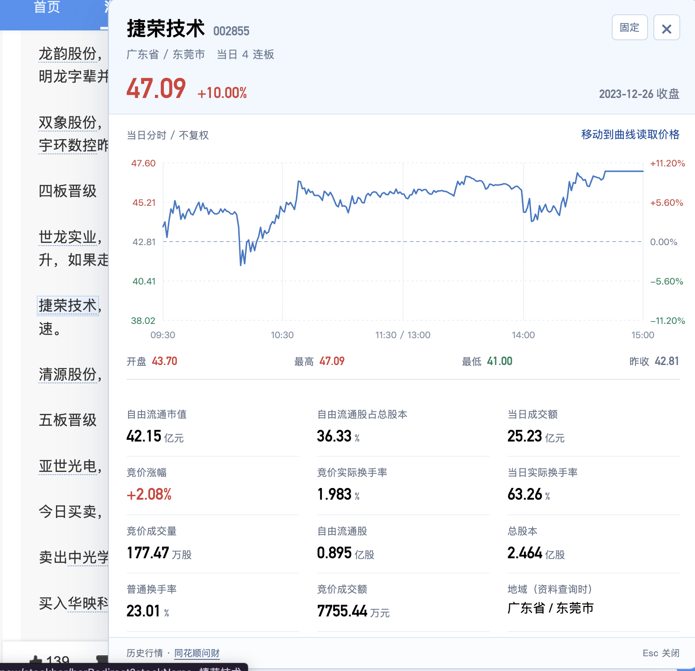

# 淘股吧原文悬浮行情

用于 Chrome / Edge 的本地浏览器扩展。在已收录的延边刺客复盘原文中，将鼠标停在股票名称上，可查看对应交易日的历史分时与指标。

## 悬浮窗效果与操作

打开已收录的淘股吧复盘原文，把鼠标移到带虚线下划线的股票名称上，即可弹出下面这样的行情悬浮窗，无需离开原文页面。

*示例：捷荣技术（002855），2023-12-26。窗口显示的是对应复盘日的历史行情。*

1. **悬浮看行情**：将鼠标停在正文的股票名称上，查看股票代码、地域、当日连板数、收盘价和涨跌幅。
2. **移动看分时**：把鼠标移到分时曲线上，读取对应时刻的价格；图下方同时列出开盘、最高、最低和昨收价格。
3. **查看详细指标**：窗口下半部分展示自由流通市值、自由流通股占比、成交额、竞价涨幅、竞价实际换手率等已取得的数据。
4. **固定或关闭**：点击右上角“固定”保留窗口；点击“×”或按 `Esc` 关闭。

## 安装

1. 下载 [完整插件安装包](./taoguba-hover-quotes-2023-2025.zip)（进入文件页后点击下载按钮）并解压。也可下载整个仓库，再解压其中的安装包。
2. 在 Chrome 打开 `chrome://extensions`（Edge 使用 `edge://extensions`）。
3. 开启开发者模式，点击“加载已解压的扩展程序”。
4. 选择安装包解压后的 `extension` 文件夹，确保该目录直接包含 `manifest.json`。
5. 点击扩展图标打开历年原文目录，进入淘股吧原文，必要时登录自己的淘股吧账号。

卡片支持固定、读取分钟价格，以及 Esc / × 关闭。原文中的股票链接保持原有跳转功能。

## 数据范围

数据快照：2026-11-13；本次整理上传：2026-11-23。

| 年份 | 原文入口 | 真实分时 | 五项核心指标齐全 |
|---|---:|---:|---:|
| 2023 | 238 | 9,550 | 9,565 |
| 2024 | 232 | 7,868 | 14,174 |
| 2025 | 245 | 6,856 | 15,664 |
| 合计 | 715 | 24,274 | 39,403 |

一个股票日期组合代表一只股票在一个复盘交易日的行情。同日多篇原文共用行情。五项核心指标为自由流通市值、自由流通股占总股本比例、成交额、竞价涨幅、竞价实际换手率。

目前包含 11,222 张完整分钟图和 13,052 张部分时点缺失的图。缺失点不插值；部分图缺少 13:00。尚未取得的数据保留为空，详情见 `extension/年度数据说明.txt`。部分昨收基准由收盘价及涨跌幅反算，卡片中明确标注；地域为资料查询时信息。

## Key 与隐私

- 插件读取安装包内预先保存的行情 JSON，使用插件不需要填写问财 API Key，也不会在悬浮时调用问财采集接口。
- 仓库不包含 API Key、密钥配置、Cookie、原始采集缓存、账户凭据或淘股吧原文全文。
- 原文由淘股吧正常提供。扩展仅处理已收录原文的正文，不处理评论和可编辑区域，不发送或保存正文。
- `.gitignore` 排除常见密钥文件。本仓库上传前对全部文件及安装 ZIP 执行密钥扫描。

## 文件

- `taoguba-hover-quotes-2023-2025.zip`：完整安装包，包含全部 726 个文件（扩展源代码、说明及历史行情 JSON），解压后加载其中的 `extension` 文件夹。
- `SHA256SUMS.txt`：安装包校验值。
- `hover-preview.png`：原文股票名称悬浮窗的实际效果截图。

行情来源：同花顺问财。原文链接：淘股吧。此工具用于历史复盘；数据仍有明确标示的缺口。
